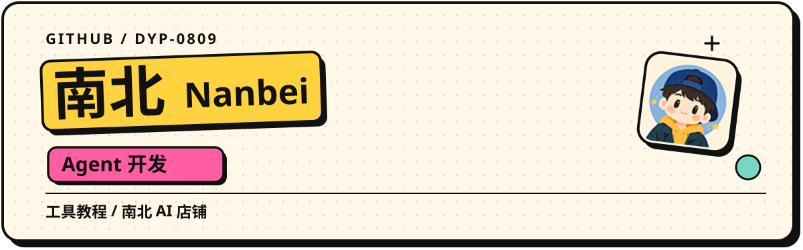

<picture>
  <source media="(max-width: 600px)" srcset="./shop-profile-mobile.svg">
  
</picture>

**[主店铺 · nanbei-ai.store ↗](https://nanbei-ai.store/)**  
**[备用店铺 · nanbei.ka8.ai ↗](https://nanbei.ka8.ai/)**

我是南北（Nanbei），做 Agent 开发，关注 AI Agent（智能体）的实际应用，也在经营南北 AI 店铺。这里放店铺介绍和自己整理的工具教程。

### 店铺与服务

两家店铺都可以浏览 AI 工具和订阅相关商品。库存、适用地区、交付方式和售后以各店说明为准。

查询订单请回到下单的店铺。[主店订单](https://nanbei-ai.store/user/index/query) · [备用店订单](https://nanbei.ka8.ai/me/orders) · [主店帮助中心](https://nanbei-ai.store/user/help/index)

[查看店铺介绍](https://github.com/dyp-0809/nanbei-ai-promotion) · [Gitee 镜像](https://gitee.com/zdhdyp/nanbei-ai-promotion)

### 安装与使用

macOS / Windows 分开讲解，配有截图和流程图。第一次使用，先选自己的系统，再按步骤操作。

**[在线阅读教程 ↗](https://dyp-0809.github.io/chatgpt-install-guide/%E6%95%99%E7%A8%8B.html)** · [下载文件](https://github.com/dyp-0809/chatgpt-install-guide) · [Gitee 镜像](https://gitee.com/zdhdyp/ai-tools-guide)

 

Agent 开发与工具使用记录，见下方项目。教程问题可在对应仓库的 Issues 中反馈。
