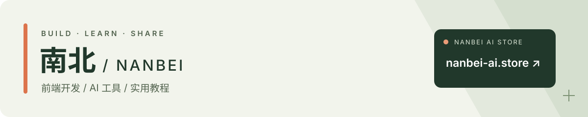

<a href="https://nanbei-ai.store/">
  <picture>
    <source media="(max-width: 600px)" srcset="./banner-mobile.svg">
    
  </picture>
</a>

**[浏览商品 ↗](https://nanbei-ai.store/)**　 [订单查询](https://nanbei-ai.store/user/index/query)　 [帮助中心](https://nanbei-ai.store/user/help/index)

我是南北，前端工程师，也在经营南北 AI 店铺。这里放店铺介绍和自己整理的工具教程。

### 店铺与服务

AI 工具、数字权益与订阅相关商品，按分类选购。交付方式、账号条件、有效期和售后范围，都在商品页面说明。

有选购或订单问题，可以从店铺右下角联系在线客服。

[查看店铺介绍](https://github.com/dyp-0809/nanbei-ai-promotion) · [Gitee 镜像](https://gitee.com/zdhdyp/nanbei-ai-promotion)

### 安装与使用

macOS / Windows 分开讲解，配有截图和流程图。第一次使用，先选自己的系统，再按步骤操作。

**[在线阅读教程 ↗](https://dyp-0809.github.io/chatgpt-install-guide/%E6%95%99%E7%A8%8B.html)** · [下载文件](https://github.com/dyp-0809/chatgpt-install-guide) · [Gitee 镜像](https://gitee.com/zdhdyp/ai-tools-guide)

 

前端开发与工具使用记录，见下方项目。教程问题可在对应仓库的 Issues 中反馈。
